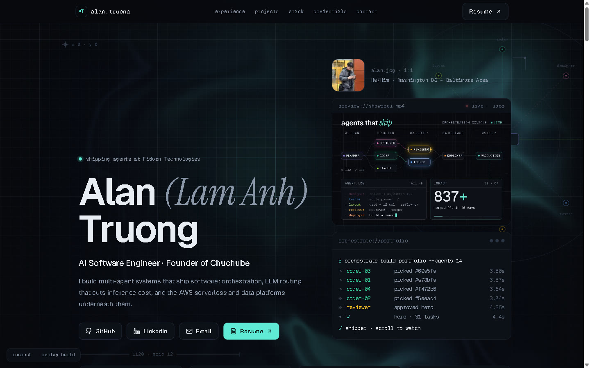
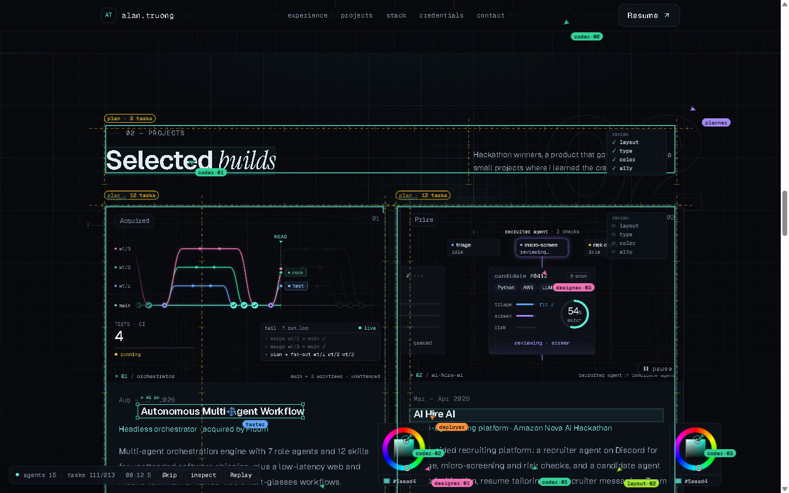
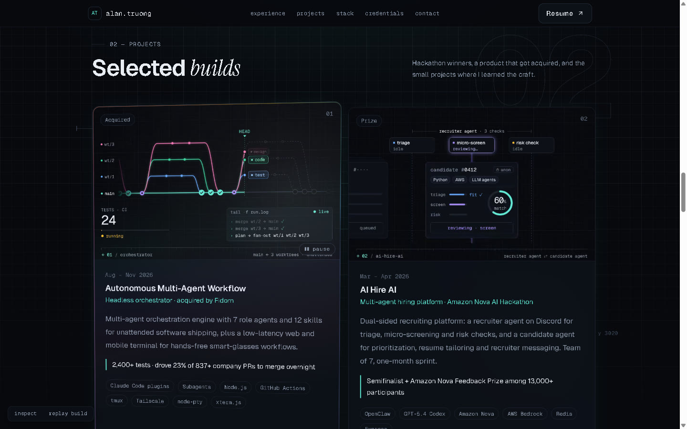

# living-ui-skills

Agent skills for building web pages that feel alive. Colored agent cursors build each section as you scroll, looping videos show the work running, and the page reacts to your pointer. Under all of it is a static page that loads fast and reads fine with JavaScript off.

The skills come out of building [lamanhtruong.com](https://www.lamanhtruong.com). Its source is public at [anhlamtruong/portfolio-anh](https://github.com/anhlamtruong/portfolio-anh) and serves as the worked example throughout.



| Agents building the projects section | Hologram tilt on a card with a looping project clip |
| --- | --- |
|  |  |

## Skills

| Skill | Use it for |
| --- | --- |
| [`living-ui`](skills/living-ui/SKILL.md) | **Start here.** The method: content first, a design system, a static page, then motion layers behind performance gates; verification, orchestrating subagents, originality, shipping. |
| [`living-ui-swarm`](skills/living-ui-swarm/SKILL.md) | The agent-swarm build animation. Role-colored cursors draw frames, type text and swap its font, drag images in, pick colors from a wheel, lay out grids, and leave a live build log. Includes the full engine. |
| [`living-ui-video`](skills/living-ui-video/SKILL.md) | Looping website videos made with [HyperFrames](https://github.com/heygen-com/hyperframes): a design spec, render and encode scripts, a `LoopVideo` component that loads clips while the page is idle and plays only what is on screen. |
| [`living-ui-effects`](skills/living-ui-effects/SKILL.md) | A WebGL aurora hero that bends around the pointer, hologram tilt cards, a grid spotlight, glitch headings and scramble links, all gated so they never fight the build or drop frames. |

Every skill ships working code in its `assets/` folder: TypeScript and React, strict mode. The full set was tested by building a fresh `create-next-app` (Next.js 15.5, React 19.1, Tailwind 4) from the skills alone: it stays static (○), every section builds, the clips load only when idle and play only on screen, and the console is clean. The engine also runs on React 18.3, in production on lamanhtruong.com.

## Install

**Claude Code plugin** (all four skills, updated together):

```bash
claude plugin marketplace add anhlamtruong/living-ui-skills
claude plugin install living-ui@living-ui
```

Or inside a Claude Code session: `/plugin marketplace add anhlamtruong/living-ui-skills`, then `/plugin install living-ui@living-ui`.

**Skills CLI** (Claude Code, Cursor, Codex, and other agents that read skills):

```bash
npx skills add anhlamtruong/living-ui-skills
```

**By hand:** copy the folders under `skills/` into `~/.claude/skills/` (or your agent's skills folder).

## Try it

Ask your agent things like:

- "My portfolio feels static. Make it feel alive like lamanhtruong.com."
- "Add an agent-swarm build animation to the landing page; only the hero builds on load."
- "Make a 10-second looping showreel for the hero and short demo loops for my three project cards."
- "Add a WebGL background to the hero and holographic tilt to the cards, without hurting mobile performance."

## Requirements

- Next.js 15 (App Router) with React 18.3 or 19 for the templates. The ideas carry over to any React setup.
- `gsap` 3.13+ (all plugins are free), `@gsap/react` and `lenis` for the engine and effects.
- For videos: Node 22+, FFmpeg (the skill shows a no-install route via `ffmpeg-static`), and the HyperFrames CLI and skills.

## Credits

- [HyperFrames](https://github.com/heygen-com/hyperframes) by HeyGen (Apache-2.0) renders the videos. Install its own skills for the composition contract; these skills only cover using it for websites.
- [GSAP](https://gsap.com) and [Lenis](https://github.com/darkroomengineering/lenis) drive the motion.
- The swarm engine, effects and video player are original work for lamanhtruong.com. The `living-ui` skill explains how to take inspiration from other sites without copying them.

## License

[MIT](LICENSE) © Anh Lam Truong
